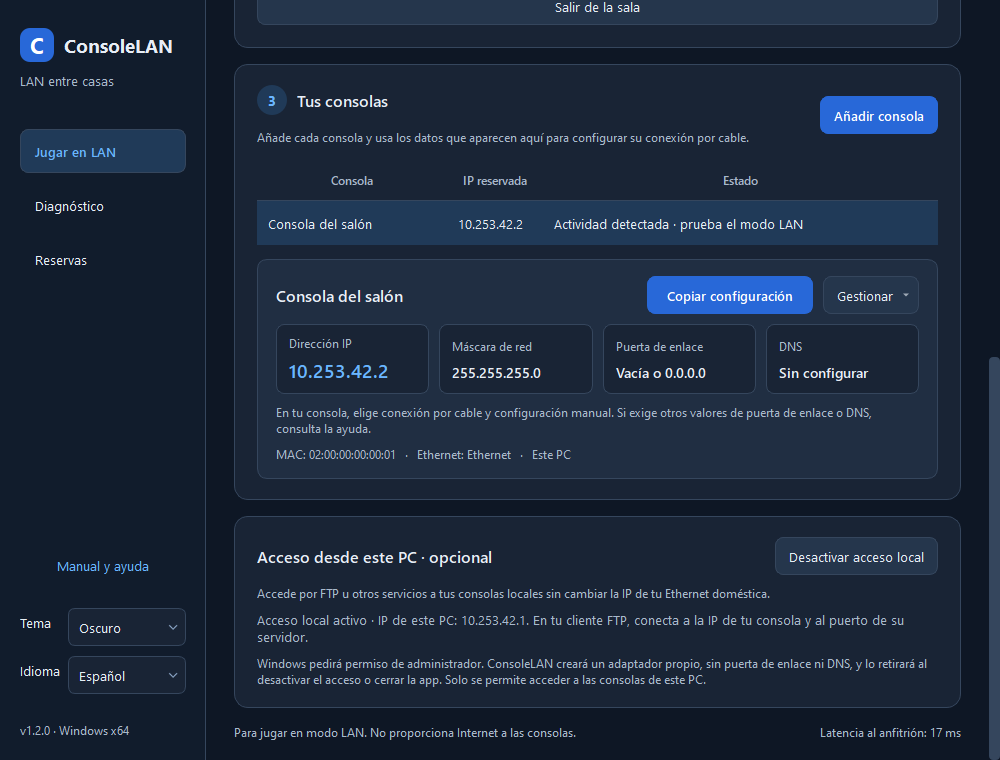
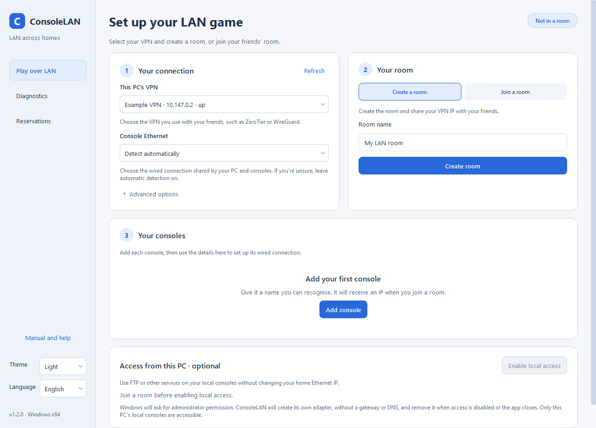

# ConsoleLAN 1.2.0

[Español](README.md) · English

Windows x64 application in C++20, Qt 6 Widgets, Winsock and Npcap for selectively extending console LAN traffic over an existing VPN. Each room's host coordinates IP reservations and relays UDP traffic. No accounts or central server are required.

## New in 1.2

- **Optional access from this PC to its local consoles**, using a dedicated signed Wintun adapter for FTP or other services while LAN gaming continues.
- Only host routes to this PC's consoles. Existing Ethernet/VPN settings, DHCP, DNS and gateways remain unchanged. No NAT or access to consoles in other homes through this feature.
- A separate elevated helper owns and removes the adapter and routes. The main app can remain unprivileged. Cancelling permission leaves access disabled.
- Cleanup on disable, room exit, app closure, lost control channel, missing heartbeats or parent-process death.
- Guided UI with clearer text, separate IP fields, copy feedback, Light/Dark themes and English/Spanish.

## Downloads

- [Windows x64 installer](https://github.com/MalfrenLasVegas/ConsoleLAN/releases/download/v1.2.0/ConsoleLAN-1.2.0-win64-setup.exe)
- [Portable package with Qt](https://github.com/MalfrenLasVegas/ConsoleLAN/releases/download/v1.2.0/ConsoleLAN-1.2.0-win64-portable.zip)
- [Full source and illustrated documentation](https://github.com/MalfrenLasVegas/ConsoleLAN/releases/download/v1.2.0/ConsoleLAN-1.2.0-source.zip)
- [SHA256 checksums](https://github.com/MalfrenLasVegas/ConsoleLAN/releases/download/v1.2.0/SHA256SUMS.txt)

Read the [1.2.0 release notes](https://github.com/MalfrenLasVegas/ConsoleLAN/releases/tag/v1.2.0). [Npcap](https://npcap.com/#download) must be installed separately. The portable package requires an up-to-date Microsoft Visual C++ Runtime x64. Qt Base sources and license notices are included in the binary packages.

## Interface





Real UI rendered with synthetic data. These screenshots do not prove console gameplay. The native integration test uses signed Wintun and real Windows TCP against a simulated FTP console; physical PS5 FTP and console gameplay still require hardware acceptance. See the [manual](docs/MANUAL.en.md) and [implementation/validation report](docs/INFORME-1.2.0.md).

## Getting started

1. Install Npcap on each Windows PC and configure a VPN with UDP connectivity between them.
2. Connect the PC and consoles by cable to the site's switch. Select the VPN and physical Ethernet separately.
3. Create a room on the host. Other PCs can discover it, or connect directly to its VPN IPv4 address when broadcast discovery is unavailable.
4. Add consoles and manually configure the IP/mask reserved by the host. MAC learning uses IPv4 source or ARP sender-IP, never an ARP question about a reservation.
5. Use the game's LAN/System Link mode and complete the [hardware acceptance checklist](docs/ACEPTACION.md).

**Actual console gameplay still requires hardware acceptance.** Promiscuous mode alone does not guarantee that a switch delivers relevant unicast traffic to the bridge PC. Console/game/firmware compatibility depends on its LAN mode. There is no Internet access, DNS, gateway, NAT, PSN integration or automatic host migration. Only one bridge PC per physical LAN is supported.

The tunnel validates room/session/endpoint and registered MAC/IP ownership. It transports Ethernet without VLAN, ARP and IPv4 up to 1514 bytes, blocks DHCP and excludes other EtherTypes. Known local unicast stays on the physical switch. Rooms rely on a trusted VPN for access security and encryption; a room ID is not user authentication.

## Build and test

Install Visual Studio C++ x64 Build Tools, CMake, Ninja and Qt with Core, Widgets and Test. The verified packaging configuration uses Qt 6.12.0 msvc2022_64.

```powershell
$env:Qt6_ROOT = 'D:\Qt\6.12.0\msvc2022_64'
.\scripts\fetch-deps.ps1 -Packaging
.\scripts\build.cmd
.\scripts\package.ps1
```

`build.cmd` runs protocol/engine checks, real Winsock loopback tests and Qt UI tests for live language switching, session state preservation, theme rendering and saved preferences. `i18n/en.json` is embedded in the executable; no external translation files or extra libraries are required. Packaging reads the version from CMake and produces versioned files in `dist/`.

Documentation: [English manual](docs/MANUAL.en.md), [Spanish manual](docs/MANUAL.md), [1.1 validation report](docs/INFORME-1.1.md), [protocol](docs/PROTOCOLO.md), [dependencies and licenses](docs/DEPENDENCIAS.md), [conceptual diagrams and clarifications](docs/IMAGENES.md).

ConsoleLAN source is MIT licensed. Dependencies retain their own licenses. Product names and console logos in the conceptual diagrams do not imply affiliation or certified compatibility.
