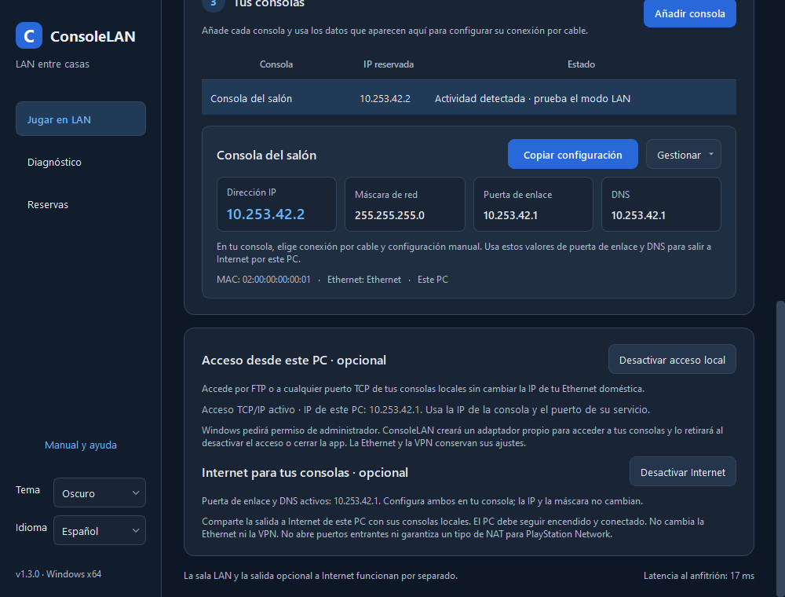
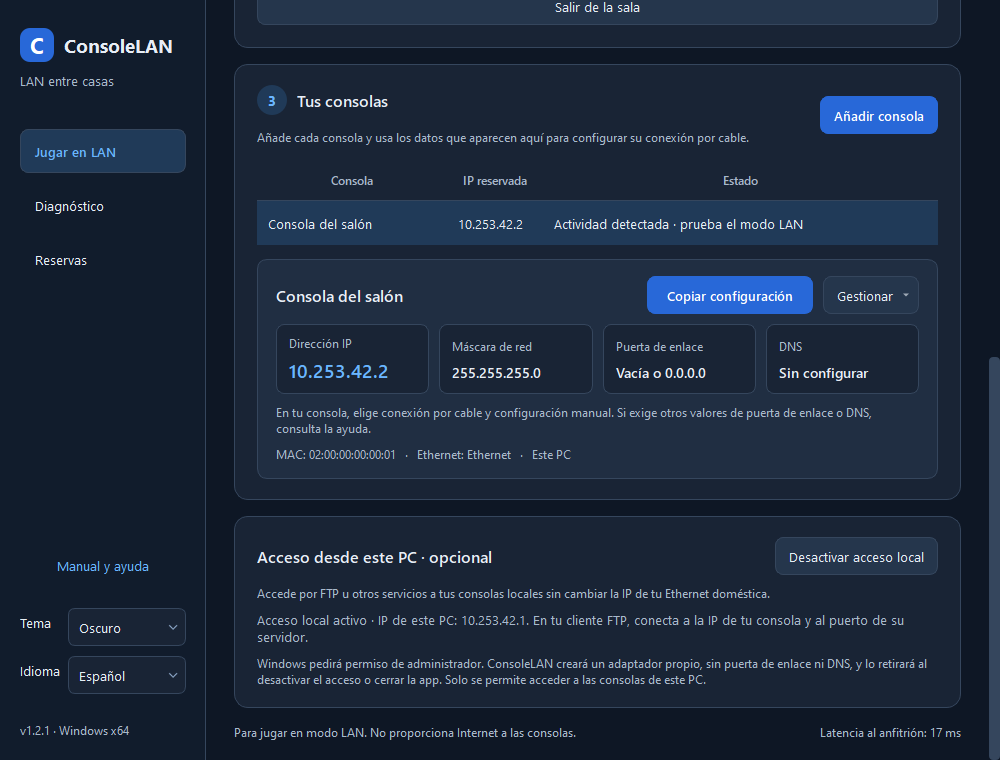
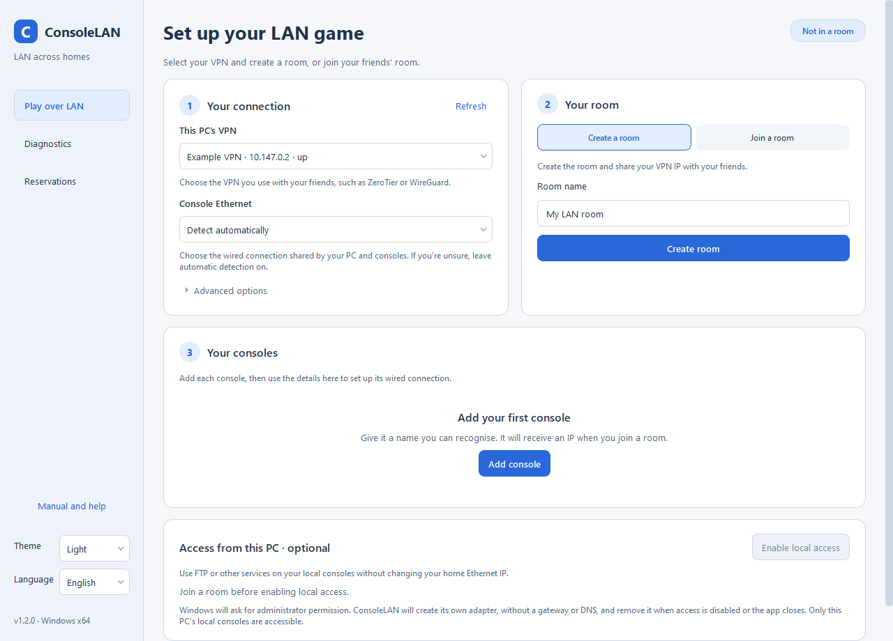

# ConsoleLAN 1.3.2

Español · [English](README.en.md)

Aplicación Windows x64 en C++20, Qt 6 Widgets, Winsock y Npcap para extender tráfico LAN de consolas sobre una VPN ya configurada. El anfitrión coordina las reservas y actúa como relay UDP. No requiere cuentas ni servidor central.

**Estado de la versión:** 54 comprobaciones del núcleo y pruebas Winsock con tres sockets reales superadas. La compatibilidad con consolas, switches y juegos requiere la [aceptación con hardware](docs/ACEPTACION.md); se han comunicado partidas reales satisfactorias, sin certificar compatibilidad universal.

## Descargar ConsoleLAN 1.3.2

- [Instalador para Windows x64](https://github.com/MalfrenLasVegas/ConsoleLAN/releases/download/v1.3.2/ConsoleLAN-1.3.2-win64-setup.exe)
- [Versión portátil con Qt](https://github.com/MalfrenLasVegas/ConsoleLAN/releases/download/v1.3.2/ConsoleLAN-1.3.2-win64-portable.zip)
- [Código fuente y documentación ilustrada](https://github.com/MalfrenLasVegas/ConsoleLAN/releases/download/v1.3.2/ConsoleLAN-1.3.2-source.zip)
- [Sumas SHA256](https://github.com/MalfrenLasVegas/ConsoleLAN/releases/download/v1.3.2/SHA256SUMS.txt)

Consulte las [notas de la Release 1.3.2](https://github.com/MalfrenLasVegas/ConsoleLAN/releases/tag/v1.3.2) antes de instalar. Npcap se instala por separado y la versión portátil requiere Microsoft Visual C++ Runtime x64 actualizado.

## Rendimiento local en 1.3.2

«Acceso desde este PC» envía por lotes nativos de Npcap únicamente el tráfico del PC a sus consolas locales, incluidas las confirmaciones TCP. Los turnos de hasta 64 paquetes atienden ambos sentidos sin esperar a llenar un lote. La sala y la VPN conservan su transporte actual; Ethernet, reservas e Internet opcional mantienen su configuración.

Las pruebas del prototipo con una PS5 física dieron aproximadamente 19 MB/s de subida individual frente a 59–67 MB/s por lotes, con archivos de prueba y verificación SHA-256. Son mediciones de ese equipo, no una garantía para juegos o clientes distintos. [Implementación, pruebas y límites](docs/INFORME-1.3.2.md).

## Internet opcional en 1.3.0

Activa **Acceso local** y después **Internet para tus consolas**. La app mostrará la `.1` de la sala como puerta de enlace y DNS para las consolas de este PC. Configúralos manualmente en la consola; conserva su IP y máscara. Cada casa comparte su propia salida a Internet, sin cambiar la Ethernet, el router o la VPN. Desactivado por defecto. [Configuración, límites y pruebas](docs/INFORME-1.3.0.md).

No instala ICS ni WinNAT y no abre puertos entrantes: no promete NAT tipo 2, UPnP ni compatibilidad universal con PSN. El PC debe permanecer encendido y conectado.



## TCP y FTP

El acceso opcional del PC admite cualquier puerto TCP de las consolas locales registradas, sin una lista de puertos limitada a FTP. Se corrige un bucle cuando Windows reenvía paquetes hacia el adaptador virtual: una protección WFP temporal y limitada a ese adaptador evita que los paquetes inyectados en Ethernet vuelvan a entrar en Wintun. No se desactiva el reenvío de la Ethernet ni de la VPN.

Validado con TCP real de Windows, FTP pasivo de subida y descarga contra un par simulado y, en una PS5 física, conexión al servidor FTP, login y listado pasivo. El usuario también ha comunicado varias partidas LAN satisfactorias entre casas; esto no constituye una certificación universal de juegos o hardware. [Detalles y límites](docs/INFORME-1.2.2.md).

## Corrección de identidad en 1.2.1

Se ignoran las tramas emitidas o retransmitidas por la propia MAC de la Ethernet del PC antes de aprender la identidad de una consola. Evita falsos conflictos IP/MAC con el reenvío de Windows activo y conserva la detección de otra consola real con IP duplicada. No cambia las reservas ni la configuración de red. Véase el [informe del parche](docs/INFORME-1.2.1.md).

## Novedades de 1.2

- **Acceso opcional del PC a sus consolas locales**: adaptador propio Wintun firmado para usar FTP u otros servicios, mientras continúa la LAN de juego. No modifica la Ethernet ni la VPN existentes.
- Solo rutas hacia las consolas de este PC. Sin ruta por defecto en el PC ni acceso a consolas de otras casas por esta función. La salida a Internet de las consolas tiene su propio interruptor opcional.
- Auxiliar elevado separado: el programa principal sigue funcionando como usuario normal. Cancelar el permiso deja el acceso desactivado.
- Retirada de las rutas y del adaptador al desactivar, salir de la sala o cerrar; protección ante pérdida del canal, latidos o proceso principal.
- Interfaz guiada y textos más claros, campos IP separados, confirmación de copia, tema claro/oscuro y español/inglés.





Capturas de la interfaz real con datos de ejemplo, no una partida verificada. Consulte el [informe de implementación y pruebas](docs/INFORME-1.2.2.md). El FTP necesita un servidor activo en la consola. La validación automatizada usa TCP real de Windows y Wintun con una consola simulada; se ha comprobado conexión, login y listado FTP pasivo en una PS5 física; las transferencias físicas y cada combinación de juego/hardware requieren aceptación propia.

## Vista general

Las siguientes imágenes son **ilustraciones conceptuales aportadas para la documentación**, no capturas de la interfaz final ni certificaciones de compatibilidad. Las VPN se ejecutan en los PC; las consolas se conectan por Ethernet a su switch local. Desde 1.3, el gateway y DNS se ofrecen solo al activar Internet opcional en cada PC.


> Las menciones de compatibilidad universal, seguridad y baja latencia en la ilustración son orientativas: dependen del hardware, el modo LAN del juego y la VPN. La reserva de IP es automática en el maestro, pero la configuración de la consola es manual. Use los valores que muestre la app, no los de la ilustración; gateway y DNS solo funcionan si Internet está activado.

## Empezar

1. Instalar Npcap desde [su página oficial](https://npcap.com/#download) en cada PC. No se incluye en esta distribución.
2. Descargar el [instalador o el ZIP portátil de la Release 1.3.2](https://github.com/MalfrenLasVegas/ConsoleLAN/releases/tag/v1.3.2). Instalar `ConsoleLAN-1.3.2-win64-setup.exe`, o descomprimir el ZIP portátil y abrir `ConsoleLAN.exe`. La versión portátil requiere Microsoft Visual C++ Runtime x64 actualizado. Al obtener únicamente el código de este repositorio, siga las instrucciones de compilación de abajo para generar `dist/`.
3. Elegir la VPN correcta y la Ethernet de las consolas. Crear una sala en un PC y entrar desde los demás mediante la IPv4 VPN del anfitrión.
4. Añadir las consolas, aplicar las IP reservadas y seguir [el manual](docs/MANUAL.md).
5. Completar [la aceptación con dos PC](docs/ACEPTACION.md) antes de dar por verificada una partida LAN.

## Compilar y probar

En una consola Windows con CMake, Ninja, Visual Studio C++ x64 y Qt con Core, Widgets y Test (empaquetado verificado con Qt 6.12.0):

```powershell
python -m pip install zstandard==0.25.0
$env:Qt6_ROOT = 'D:\Qt\6.12.0\msvc2022_64'
.\scripts\fetch-deps.ps1 -Packaging
.\scripts\build.cmd
.\scripts\package.ps1
```

`build.cmd` localiza Visual Studio con vswhere, configura CMake y ejecuta CTest, incluidas las nuevas pruebas Qt de idioma, tema y persistencia. El SDK de Npcap se usa solo para compilar cabeceras. La DLL se carga desde el directorio Npcap de Windows; no se enlaza ni se distribuye una copia privada del controlador.

Para una instalación de Qt distinta, ajustar `Qt6_ROOT`. Para un SDK de Npcap distinto, pasar `-DNPCAP_SDK=...` a CMake. La actualización y sus comprobaciones figuran en [el informe 1.1](docs/INFORME-1.1.md); el [informe 1.0](docs/INFORME.md) se conserva como historial.

## Organización

| Módulo | Responsabilidad |
| --- | --- |
| `protocol.*` | Cabecera binaria, fragmentación, reensamblado, deduplicación y estimación de pérdidas |
| `ethernet.*` | Análisis y filtrado Ethernet/ARP/IPv4, validación de origen y decisión de reenvío |
| `room.*` | Handshake, miembros, reservas autoritativas, relay, heartbeats y descubrimiento |
| `network.*` | Adaptadores/rutas Windows y UDP Winsock limitado a la VPN |
| `capture.*` | Carga segura de Npcap, captura promiscua, inyección y detección de puentes duplicados |
| `store.*` | JSON persistente con escritura atómica |
| `worker.*` | Hilo de red, colas limitadas, ciclo de recursos y registros |
| `window.*`, `presentation.*`, `i18n/en.json` | Interfaz español/inglés con temas claro/oscuro y preferencias persistentes |
| `tests/` | Ethernet simulada, tres nodos y sockets Winsock reales |

Documentación adicional: [protocolo y límites](docs/PROTOCOLO.md), [dependencias y licencias](docs/DEPENDENCIAS.md), [diagnóstico](docs/DIAGNOSTICO.md).

## Esquema de las sedes


Cada sala tiene su propio anfitrión, que es coordinador y relay; no existe un maestro global ni un servidor central. Los PC participan en una sala a la vez. Las subredes y direcciones de la lámina son ejemplos; el maestro asigna las reservas reales tras comprobar solapamientos. El túnel lleva selectivamente ARP e IPv4 de consolas registradas, bloqueando DHCP. Consulte las [aclaraciones de las ilustraciones](docs/IMAGENES.md) para interpretar sus diferencias con la versión 1.1.

Código de ConsoleLAN bajo MIT. Las dependencias conservan sus licencias. La existencia de ejecutable e instalador no equivale a una certificación de consolas, switches o juegos.
