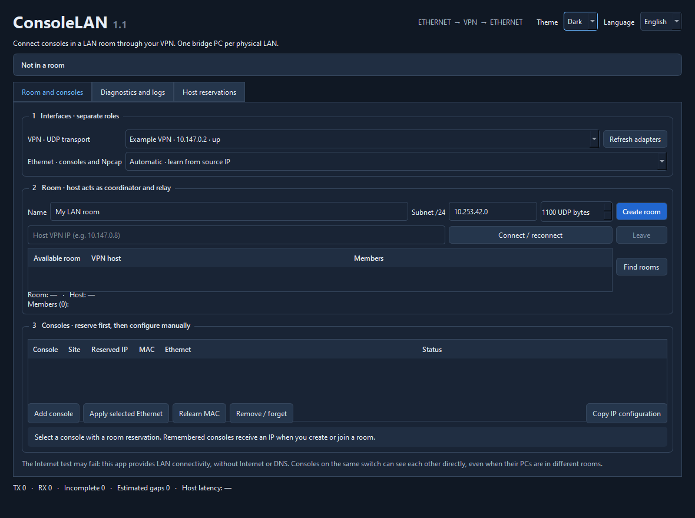
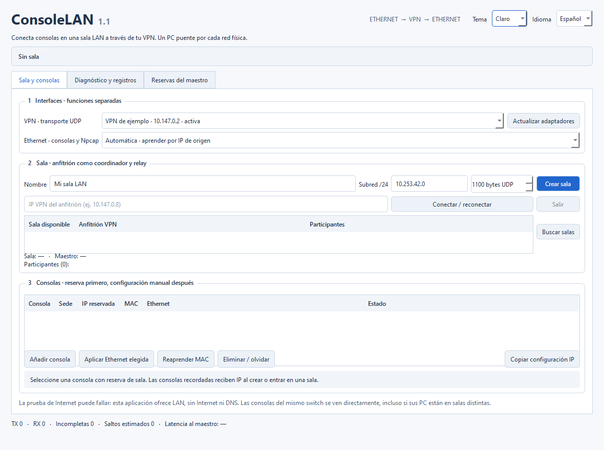
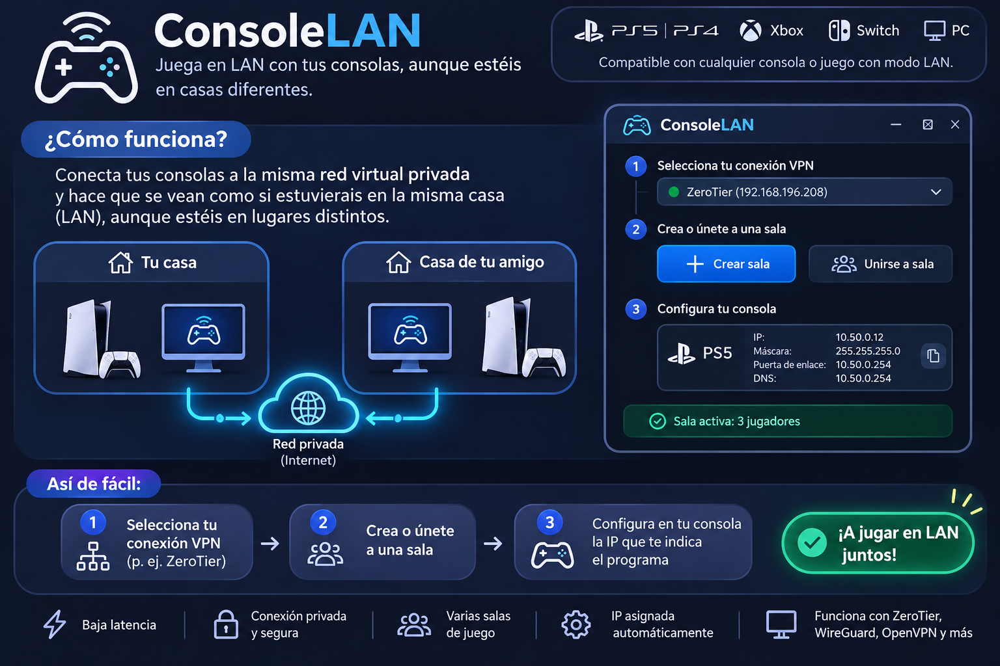
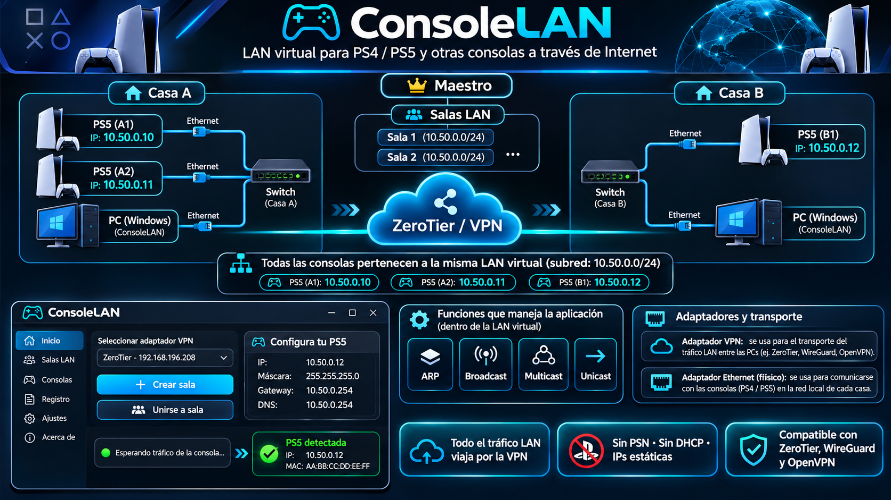

# ConsoleLAN 1.1

Español · [English](README.en.md)

Aplicación Windows x64 en C++20, Qt 6 Widgets, Winsock y Npcap para extender tráfico LAN de consolas sobre una VPN ya configurada. El anfitrión coordina las reservas y actúa como relay UDP. No requiere cuentas ni servidor central.

**Estado de la versión:** 54 comprobaciones del núcleo y pruebas Winsock con tres sockets reales superadas. La compatibilidad con consolas, switches y juegos requiere la [aceptación con hardware](docs/ACEPTACION.md); todavía no se ha certificado una partida real.

## Descargar ConsoleLAN 1.1.0

- [Instalador para Windows x64](https://github.com/MalfrenLasVegas/ConsoleLAN/releases/download/v1.1.0/ConsoleLAN-1.1.0-win64-setup.exe)
- [Versión portátil con Qt](https://github.com/MalfrenLasVegas/ConsoleLAN/releases/download/v1.1.0/ConsoleLAN-1.1.0-win64-portable.zip)
- [Código fuente y documentación ilustrada](https://github.com/MalfrenLasVegas/ConsoleLAN/releases/download/v1.1.0/ConsoleLAN-1.1.0-source.zip)
- [Sumas SHA256](https://github.com/MalfrenLasVegas/ConsoleLAN/releases/download/v1.1.0/SHA256SUMS.txt)

Consulte las [notas de la Release 1.1.0](https://github.com/MalfrenLasVegas/ConsoleLAN/releases/tag/v1.1.0) antes de instalar. Npcap se instala por separado y la versión portátil requiere Microsoft Visual C++ Runtime x64 actualizado.

## Novedades de 1.1

- **Tema claro y oscuro**, con tablas, campos, estados deshabilitados y diálogos adaptados.
- **Español e inglés** seleccionables en la cabecera, sin reiniciar ni salir de la sala.
- Preferencias guardadas al momento y restauradas al abrir. Se conservan nombres, IP, reservas y selección de interfaces.
- Manual bilingüe integrado, diagnóstico y registros visibles traducidos, e instalador en ambos idiomas.
- Corrección de un posible cierre al refrescar las tablas de una sesión.





Estas dos capturas muestran la interfaz real renderizada por las pruebas de UI, con una **etiqueta de VPN de ejemplo**, no una conexión ni una partida verificada. Los selectores **Tema** e **Idioma** están arriba a la derecha. Consulte el [informe de la actualización](docs/INFORME-1.1.md).

## Vista general

Las siguientes imágenes son **ilustraciones conceptuales aportadas para la documentación**, no capturas de la interfaz final ni certificaciones de compatibilidad. Las VPN se ejecutan en los PC; las consolas se conectan por Ethernet a su switch local. ConsoleLAN no proporciona Internet, gateway ni DNS a las consolas.



> Las menciones de compatibilidad universal, seguridad y baja latencia en la ilustración son orientativas: dependen del hardware, el modo LAN del juego y la VPN. La reserva de IP es automática en el maestro, pero la configuración de la consola es manual. Los valores de gateway/DNS dibujados no corresponden a servicios ofrecidos por ConsoleLAN.

## Empezar

1. Instalar Npcap desde [su página oficial](https://npcap.com/#download) en cada PC. No se incluye en esta distribución.
2. Descargar el [instalador o el ZIP portátil de la Release 1.1.0](https://github.com/MalfrenLasVegas/ConsoleLAN/releases/tag/v1.1.0). Instalar `ConsoleLAN-1.1.0-win64-setup.exe`, o descomprimir el ZIP portátil y abrir `ConsoleLAN.exe`. La versión portátil requiere Microsoft Visual C++ Runtime x64 actualizado. Al obtener únicamente el código de este repositorio, siga las instrucciones de compilación de abajo para generar `dist/`.
3. Elegir la VPN correcta y la Ethernet de las consolas. Crear una sala en un PC y entrar desde los demás mediante la IPv4 VPN del anfitrión.
4. Añadir las consolas, aplicar las IP reservadas y seguir [el manual](docs/MANUAL.md).
5. Completar [la aceptación con dos PC](docs/ACEPTACION.md) antes de dar por verificada una partida LAN.

## Compilar y probar

En una consola Windows con CMake, Ninja, Visual Studio C++ x64 y Qt con Core, Widgets y Test (empaquetado verificado con Qt 6.12.0):

```powershell
$env:Qt6_ROOT = 'D:\Qt\6.12.0\msvc2022_64'
.\scripts\fetch-deps.ps1 -Packaging
.\scripts\build.cmd
.\scripts\package.ps1
```

`build.cmd` localiza Visual Studio con vswhere, configura CMake y ejecuta CTest, incluidas las nuevas pruebas Qt de idioma, tema y persistencia. El SDK de Npcap se usa solo para compilar cabeceras. La DLL se carga desde el directorio Npcap de Windows; no se enlaza ni se distribuye una copia privada del controlador.

Para una instalación de Qt distinta, ajustar `Qt6_ROOT`. Para un SDK de Npcap distinto, pasar `-DNPCAP_SDK=...` a CMake. La actualización y sus comprobaciones figuran en [el informe 1.1](docs/INFORME-1.1.md); el [informe 1.0](docs/INFORME.md) se conserva como historial.

## Organización

| Módulo | Responsabilidad |
| --- | --- |
| `protocol.*` | Cabecera binaria, fragmentación, reensamblado, deduplicación y estimación de pérdidas |
| `ethernet.*` | Análisis y filtrado Ethernet/ARP/IPv4, validación de origen y decisión de reenvío |
| `room.*` | Handshake, miembros, reservas autoritativas, relay, heartbeats y descubrimiento |
| `network.*` | Adaptadores/rutas Windows y UDP Winsock limitado a la VPN |
| `capture.*` | Carga segura de Npcap, captura promiscua, inyección y detección de puentes duplicados |
| `store.*` | JSON persistente con escritura atómica |
| `worker.*` | Hilo de red, colas limitadas, ciclo de recursos y registros |
| `window.*`, `presentation.*`, `i18n/en.json` | Interfaz español/inglés con temas claro/oscuro y preferencias persistentes |
| `tests/` | Ethernet simulada, tres nodos y sockets Winsock reales |

Documentación adicional: [protocolo y límites](docs/PROTOCOLO.md), [dependencias y licencias](docs/DEPENDENCIAS.md), [diagnóstico](docs/DIAGNOSTICO.md).

## Esquema de las sedes



Cada sala tiene su propio anfitrión, que es coordinador y relay; no existe un maestro global ni un servidor central. Los PC participan en una sala a la vez. Las subredes y direcciones de la lámina son ejemplos; el maestro asigna las reservas reales tras comprobar solapamientos. El túnel lleva selectivamente ARP e IPv4 de consolas registradas, bloqueando DHCP. Consulte las [aclaraciones de las ilustraciones](docs/IMAGENES.md) para interpretar sus diferencias con la versión 1.1.

Código de ConsoleLAN bajo MIT. Las dependencias conservan sus licencias. La existencia de ejecutable e instalador no equivale a una certificación de consolas, switches o juegos.
