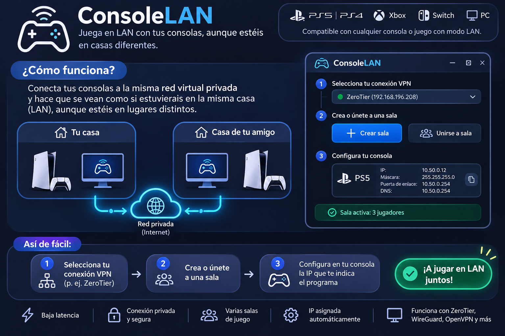
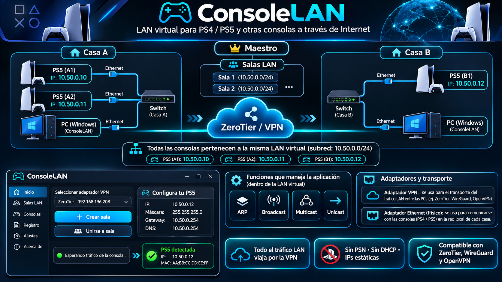

# Ilustraciones de ConsoleLAN

Estas dos láminas fueron aportadas para ilustrar el objetivo y la disposición de la red. Se incluyen sin modificar los originales. No son capturas de la interfaz de ConsoleLAN 1.0 ni resultados de pruebas de compatibilidad.

## Vista general

## Arquitectura de ejemplo

## Cómo interpretar las imágenes

| Elemento de la lámina | Comportamiento real de ConsoleLAN 1.0 |
| --- | --- |
| Consolas conectadas a una VPN | La VPN está en los PC Windows. Las consolas usan Ethernet con su switch local; el PC captura e inyecta mediante Npcap. |
| PS4, PS5, Xbox, Switch y cualquier juego LAN | Son ejemplos de equipos. No se ha certificado compatibilidad con esas consolas ni con todos sus juegos; se requiere modo LAN adecuado y aceptación real. |
| Gateway y DNS `10.50.0.254` | Son valores del dibujo, no servicios implementados. ConsoleLAN no ofrece gateway, DNS ni Internet. Siga la configuración del manual y la IP reservada que muestre la aplicación. |
| Una interfaz oscura con menús laterales | Es una representación conceptual. La versión 1.0 usa Qt Widgets con pestañas para sala/consolas, diagnóstico y reservas del maestro. |
| Maestro sobre varias salas | Cada sala tiene su propio anfitrión y relay. No hay un maestro global ni un servidor central. Un PC está en una sala a la vez. |
| IP asignada automáticamente | El maestro reserva automáticamente una IP única. La dirección y máscara se configuran manualmente en la consola. |
| Todo el tráfico LAN viaja por la VPN | Se transporta selectivamente ARP e IPv4 de consolas registradas. DHCP, IPv6 y otros EtherTypes quedan excluidos; el unicast local conocido permanece en el switch. |
| Baja latencia y conexión segura | La latencia depende de la VPN, la distancia y el relay; se muestra RTT al maestro, no ping entre consolas. La seguridad de acceso y el cifrado dependen de la VPN de confianza; la sala no autentica usuarios. |
| Subred `10.50.0.0/24` | Es un ejemplo. La aplicación permite una subred privada /24 y comprueba solapamientos en cada sede al crear o entrar. |

Los nombres, logotipos y diseños de plataformas presentes en las ilustraciones identifican equipos de ejemplo y no implican afiliación, patrocinio o certificación. Para instalar y probar la aplicación consulte el [manual](MANUAL.md), el [protocolo](PROTOCOLO.md) y la [guía de aceptación](ACEPTACION.md).
